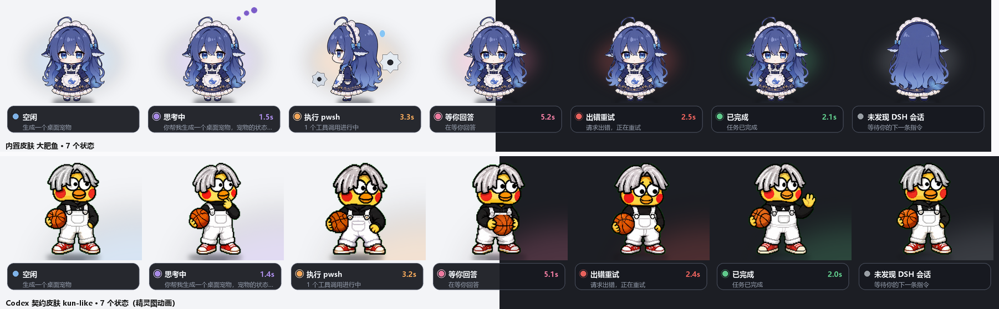

# DSH 桌宠 · 大肥鱼

一只悬浮在桌面上的透明小宠物，**实时显示 DeepSeek Harness 中所有正在进行的任务**。
我正在思考时她托腮，执行工具时她转身拿齿轮干活，**卡在等你回答时她举手**，
**任务跑完时她庆祝**；同时跑着几个会话，她一次全列出来。



**特性**

- **七种状态**实时跟随 DSH 会话：空闲 / 思考中 / 执行中 / 等你回答 / 出错重试 / 已完成 / 离线
- **多会话并排**：同时跑几个任务时一次全列出来，不是只显示一个
- **真透明窗口**：`WS_EX_LAYERED` + `UpdateLayeredWindow` 做逐像素 alpha，边缘平滑、可拖拽
- **六套内置皮肤**，并支持两种第三方素材格式（Codex 精灵图契约 / clawd 主题）
- **隐私模式**：一键隐藏标题与提示词，只留状态
- **托盘图标 + 完成提示音**
- 纯 Python + Pillow，无网络、无遥测，只读 DSH 自己的会话文件

---

## 快速开始

```bash
git clone <本仓库>
cd desktop-pet
python dsh_pet.py
```

只依赖 **Python 3.10+** 和 **Pillow**（可选：`pystray` 托盘图标、`numpy` 用于 clawd 主题的 SVG 光栅化）。

Windows 上也可以双击 **`启动桌宠.vbs`**（静默启动，不弹控制台）；
出问题时用 **`调试启动.bat`** 看报错。

```bash
python dsh_pet.py --demo                 # 每 3 秒轮换状态，预览用
python dsh_pet.py --shot 前缀            # 不建窗口，把各状态渲染成 PNG
python dsh_pet.py --session <id>         # 只监视指定的一个会话
python dsh_pet.py --force-state tools    # 锁定某个状态
python dsh_pet.py --list-skins           # 列出可用皮肤
python dsh_pet.py --skin kun-like        # 指定皮肤启动
```

右键菜单可切换 **隐私模式**、**提示音**、**皮肤**；
左键单击 **戳一下**（角色会播一次反应动画）并展开详情卡，拖动可移动窗口。

---

## DSH 界面里的开关按钮

> ⚠️ **状态：Host 半已验证可用，客户端按钮尚未验证。**
> 插件会随 DSH 启动自动拉起桌宠，`/dsh-pet/status` 与 `/dsh-pet/toggle` 两条路由
> 实测返回正常；但侧边栏那个按钮目前**没有出现**，原因还在查
> （客户端模块图是否收录本包，需要看 `window.__DSH_BOOT__` 才能定位）。
> 也就是说：**自动启动能用，界面按钮还不能用。**

装了一个 DSH 插件，**在侧边栏底部（与「设置」同排）加一个爪印按钮**，
点击即可打开/关闭桌面宠物，按钮颜色反映运行状态：

| 按钮外观 | 含义 |
|---|---|
| 灰色爪印 | 桌宠未运行，点击打开 |
| 品牌色爪印 | 桌宠运行中，点击关闭 |
| 红色爪印 | 出错，悬停可看原因 |

按钮每 3 秒轮询一次状态，所以从桌宠那边右键退出，按钮也会跟着变灰。

### 随 DSH 启动

插件里带 `autostart`（默认开），所以 **DSH 一起来桌宠就自动出现**，不用手动点。
在补丁行里设 `autostart: false` 可关掉。

桌宠自身有**单实例锁**（绑本地端口 `51937`，进程退出时由系统自动释放）——
插件、快捷方式、手动启动三条路都走同一个入口，**不会叠出第二只**。

### 它是怎么接进 DSH 的

插件包在 [`dsh-plugin/`](dsh-plugin/)，是一个标准的 DSH bundle：

```
dsh-plugin/
├── package.json          dsh.bundle.patch + dsh.client 声明
├── cordis.patch.yml      把插件行插进 web 组合
└── lib/
    ├── index.js          Host 半：ctx.subprocess 管进程 + ctx.webServer 开路由
    └── client.js         Client 半：往 sidebar.footer.action 注册按钮
```

- **Host 半**用 `ctx.subprocess.spawn()` 启动桌宠（`pythonw.exe`，无控制台窗口），
  用 `handle.done` 跟踪退出，用 `handle.terminate()` 关闭
- **通信走 HTTP**，不走 typert Remote：Host 注册 `/dsh-pet/status` 与 `/dsh-pet/toggle`
  两条同源路由，浏览器侧 `fetch` 直接调用 —— Remote 需要生成式 schema，太重了
- **插件停用时会连带关掉桌宠**，不留孤儿进程

安装方式（已装好，这里是记录）：

```bash
dsh plugin --profile <profile> add <插件目录>
```

⚠️ 注意：**Electron 桌面版独占管理 `desktop` profile**，CLI 会拒绝操作它。
本项目是直接把包链接到 `profiles/node_modules/`，并在
`profiles/desktop/cordis.patch.yml` 里加了一行 insert —— 该文件就是用户补丁层，
且补丁是**热加载**的，改完无需重启。

---

## 七种状态

| 聚合状态 | 判定条件（DSH 投影缓存字段） | 形象 |
|---|---|---|
| 🟦 **空闲** | 没有任何会话在生成或跑工具 | 正面站立 |
| 🟪 **思考中** | `sessionStats.openStep` 存在 | 正面 + 三个跳动圆点 |
| 🟧 **执行中** | `sessionStats.pendingCalls` 非空 | **侧面**转身 + 旋转齿轮 |
| 🩷 **等你回答** | `userQuestions.questions.active` 非空 | 正面 + 粉色光晕 |
| 🟥 **出错重试** | `llmRetry` 非空 | 正面 + 红色光晕 |
| 🟩 **已完成** | `turnBoundary.openTurnStartSeq` 由非空转 null | 庆祝动作 |
| ⬜ **离线** | 找不到任何 DSH 会话 | **背面** |

**优先级**：等你回答 > 出错 > 执行 > 思考 > 已完成 > 空闲。
理由很实际 —— **卡在你这儿**是最该被看见的，所以它排第一。

「已完成」是**转换检测**出来的，不是某个字段的值：监视 `openTurnStartSeq`
从「有」变成 `null` 的那一刻，就认为那个会话刚跑完一个回合，庆祝 6 秒。

---

## 任务是怎么算的

**一个 DSH 会话算一个任务。** 桌宠扫描全部会话，把在跑的挑出来，按状态优先级排序后全部列出：

- **角色**显示**聚合状态** —— 只要有一个任务在跑工具，她就转身拿齿轮
- **折叠的信息卡**：单任务显示状态 + 工具名 + 耗时；
  多任务显示「N 个任务进行中」，下面逐行列出每个任务的标题、状态、耗时
- **展开的详情面板**：多任务时列出（最多 3 个，更多的折叠计数），
  再接主任务的模型、进度、token 与上下文条

排序规则是「按状态优先级，同类按开始时间」，因此列表顺序稳定，不会来回跳。

---

## 皮肤

仓库带**六套皮肤**，右键菜单可切换，**同时支持两种生态的素材格式**：

| 皮肤 | 来源 | 格式 | 授权 |
|---|---|---|---|
| **大肥鱼** | 内置 | 三视图 + 程序化姿态 | 本项目 |
| **kun-like** | [dsh-kun-like-pet](https://github.com/liyupi/dsh-kun-like-pet) | Codex 契约 `1536×1872` | MIT |
| **openpets** | [openpets](https://github.com/OpenPetsHQ/openpets) | Codex 契约扩展 `1536×2288` | MIT |
| **matcha-cheeky** | [MatchaDandan](https://github.com/CaptainRong/MatchaDandan) | Codex 契约扩展 `1536×2288` | MIT |
| **matcha-gentle** | 同上 | 同上 | MIT |
| **matcha-sunny** | 同上 | 同上 | MIT |


> **为什么仓库里没有 clawd 主题素材？**
>
> 加载器支持 clawd 主题格式（代码在仓库里，MIT），但**素材一套都没打包**，原因是授权：
>
> | 主题 | 授权 | 为什么排除 |
> |---|---|---|
> | calico / cloudling | 美术**权利未明确** | 上游源码是 AGPL-3.0，但 README 明说该许可不自动适用于美术，也没单独授权。本地自用可以，**公开再分发是另一回事** |
> | 鲸鱼娘 Whale-chan | CC BY-NC-SA 4.0 | 许可允许非商业移植，但 **SA（相同方式共享）有传染性** —— 会要求整个衍生作品同样以 CC BY-NC-SA 发布，与本仓库的 MIT 冲突；体积也有 157MB |
> | 哈希仙人 Hash Sage | 保留全部权利 | 许可明确禁止 `use these materials in another project` |
>
> 所以**你自己放主题进去**就能用，见下一节。这不是技术限制，是授权边界。
> 完整说明见 [ATTRIBUTION.md](assets/ATTRIBUTION.md)。

### 格式一：Codex 桌宠精灵图契约

| 项目 | 规格 |
|---|---|
| 单格 | `192 × 208` |
| 网格 | 8 列；**至少 9 行** |
| 行定义 | 0 待机 · 1 向右跑 · 2 向左跑 · 3 挥手 · 4 跳跃 · 5 出错 · 6 等待回复 · 7 专注干活 · 8 思考审阅 |
| 行 9+ | 允许扩展（openpets 就多画了 2 行） |

放到下面任一目录即可被识别，**不用改代码**：

```
<程序目录>/assets/skins/<名称>/spritesheet.webp
~/.codex/pets/<名称>/spritesheet.webp        ← Codex 桌宠官方目录
```

### 格式二：clawd 主题

主题目录顶层放 `theme.json`，资源在 `assets/` 下：

```
<名称>/
  theme.json              ← 必需，含 states 映射
  assets/
    <状态>.apng / .svg / .gif / .webp / .png
```

扫描目录：

```
<程序目录>/assets/skins/clawd/<名称>/
%APPDATA%/clawd-on-desk/themes/<名称>/       ← clawd 的用户主题目录
```

**状态映射**（clawd 的状态名 → 本项目的 7 个状态）：

| 本项目 | clawd 状态（按优先级） |
|---|---|
| 空闲 | `idle` · `dozing` · `yawning` |
| 思考中 | `thinking` · `sweeping` |
| 执行中 | `working` · `carrying` · `juggling` |
| 等你回答 | `attention` · `notification` |
| 出错重试 | `error` |
| 已完成 | `notification` · `attention` |
| 离线 | `sleeping` · `collapsing` |

**资源格式支持情况**：

| 格式 | 支持 | 说明 |
|---|---|---|
| APNG / GIF / WebP / PNG / JPG | ✅ 完整 | Pillow 原生，**动画完整**，逐帧时长也读得到 |
| 静态 SVG | ✅ 完整 | 光栅化后使用 |
| **脚本驱动 SVG** | ⚠️ **仅静止帧** | 见下 |

### 关于脚本 SVG（重要限制）

clawd 的很多 SVG 是 **JS 驱动**的（cloudling 自称 "scripted SVG object-channel assets"），
动画由内嵌 `<script>` 在运行时算出来。光栅化只能拿到一帧静止画面，**那些部分会丢失**。
实测 cloudling：云朵角色、眼睛、出错态的 X 眼都在，但**打字的手、动作等只剩一团云**。

Calico 不受影响 —— 它只有 `idle` 用 SVG（且是眼球追踪用的 `-follow.svg`），
加载器会**自动换成同名的 APNG 兄弟文件**，所以动画是完整的。

### 三个实现细节

- **帧数不写死** —— Codex 契约数该行非空格子；clawd 主题用 Pillow 读 `n_frames`。
- **按内容框缩放** —— clawd 主题画布留白差异极大（calico 266×200、cloudling 88×72），
  按整图缩放角色会很小。改成按**所有帧的内容并集**裁切再缩放，
  用并集而不是逐帧裁切，角色才不会在帧间抖动。
- **SVG 透明背景** —— 本机没有 cairo（`cairosvg` 与 `reportlab` 的 renderPM 三个后端全缺），
  走 `svglib → PDF → pypdfium2`。PDF 渲染是不透明白底，于是**黑底白底各渲一次再解方程**：
  `alpha = 255 - max(白 - 黑)`、`color = 黑 / (alpha/255)`。

> ⚠️ 素材授权：clawd 的内置主题美术权利状态**未明确**（源码是 AGPL-3.0，
> 但 README 说该许可不自动适用于美术，也没单独授权）。哈希仙人**明确禁止**移植。
> 详见 [ATTRIBUTION.md](assets/ATTRIBUTION.md)。

---

## 隐私模式

学 [openpets](https://github.com/OpenPetsHQ/openpets) 的做法：**气泡里不放提示词、代码、路径**。

| | 普通模式 | 隐私模式 |
|---|---|---|
| 任务行标题 | 会话标题（由你的提问生成） | `会话 1` / `会话 2` |
| 副行文案 | 提示词片段 | 「模型正在生成」等通用文案 |

右键菜单或 `--privacy` 切换，状态存在 `pet_config.json`。


---

## 托盘图标与提示音

- **托盘图标**：桌宠被窗口挡住时，托盘仍显示当前状态（图标 = 该状态首帧缩到 64px，
  悬停提示显示状态名）。托盘菜单可显示/隐藏桌宠、切换详情、隐私模式、退出。
- **提示音**：任务跑完时播一声系统提示音（`SystemAsterisk`）。
  多个任务同时完成只响一次（3 秒去重）。

两者都可在右键菜单里关掉。

---

## 状态是怎么读到的

桌宠不修改 DSH，也不装插件 —— 它只**只读**两份 DSH 自己写的文件：

**1. 会话投影缓存**（主要来源，明文 JSON）

```
<DSH_HOME>/storages/session_projcache/sessions/session-<id>.json
```

| 字段 | 用途 |
|---|---|
| `rows.sessionStats.val.openStep` | `{turn, step, startTime, firstTokenTime}`，非 null = 正在生成 |
| `rows.sessionStats.val.pendingCalls` | `{callId: 开始时间}`，非空 = 有工具在跑 |
| `rows.userQuestions.val.questions.active` | 非空 = 有提问在等你回答 |
| `rows.llmRetry.val` | 非空 = 请求出错正在重试 |
| `rows.turnBoundary.val.openTurnStartSeq` | 非 null = 回合进行中；转 null = 刚跑完 |
| `rows.inbox.val` | `next-turn` / `next-step` 非空 = 有排队中的消息 |
| `rows.plan.val.active` | 处于计划模式 |
| `rows.goal.val.current.goal.objective` | 该会话的长期目标 |
| `rows.modelSelection.val.lastUsed` | 当前 provider / model |
| `rows.contextPressure.val` | 上下文占用与窗口大小 |
| `rows.tokenUsage.val.totals` | 累计输出 token |
| `rows.title.val` / `rows.turnOutline.val` | 会话标题 / 当前提示词 |

**2. 会话事件日志**（只为拿工具名）

```
<DSH_HOME>/sessions/*/session-<id>/session*.jsonl.zstd
```

这是追加写的 zstd 流，且 **Python 无法持续持有解压流**（实测 `decompressobj` 不可复用、
`stream_reader` 不会读到后续追加的数据）。因此按 **zstd 帧魔数** `28 B5 2F FD` 切分，
逐帧独立解压，只解上次之后新增的帧 —— 每轮开销恒定，不受日志总长影响。

从 `tool/call` 事件里取 `callId → name`，就能把 `pendingCalls` 里的 callId 还原成
`pwsh` / `read` / `grep` 这样的工具名。

**多会话**：每次轮询都会扫描全部会话文件，把所有「生成中 / 跑工具中」的都收集起来。
投影缓存按 **mtime + size** 缓存，文件没变就不重新解析 ——
实测 10 个会话下，一轮轮询中位 **0.8ms**、最差 14ms，远低于 350ms 的轮询间隔。

工具名只为**活跃会话**建增量日志读取器（空闲会话用不上），
并限制最多保留 6 个，避免读遍所有会话的事件日志。

用 `--session` 可以锁定单个会话；右键菜单的「自动跟随活跃会话」可以解除锁定。

---

## 交互

| 操作 | 效果 |
|---|---|
| 左键拖动 | 移动位置（自动记忆） |
| 单击 | 展开 / 收起详情面板 |
| 右键 | 菜单：详情、自动跟随、复制会话 ID、**隐私模式**、**提示音**、**皮肤**、退出 |
| 托盘图标 | 显示/隐藏桌宠、切详情、切隐私、退出 |

位置、详情展开、隐私、提示音、皮肤都存在 `pet_config.json`。

---

## 实现要点

**逐像素透明窗口**。tkinter 本身做不到，所以用 `WS_EX_LAYERED` +
`UpdateLayeredWindow` 直接推送带 alpha 的 32 位位图，得到边缘平滑的真透明，
而不是 `-transparentcolor` 那种抠色（会有色边）。

两个踩过的坑，都写在代码注释里：

- `UpdateLayeredWindow` 的 `pptDst` 参数**会移动窗口**。传坐标进去的话，
  每帧都把窗口搬到那个坐标，Tk 设置的 `geometry` 全被覆盖 —— 必须传 `NULL`。
- 预乘 alpha 不要用 Python 逐像素循环（每帧 5 万次迭代太慢）。
  用 `ImageChops.multiply` 逐通道乘 alpha，再让 PIL 以 `"BGRA"` 原始模式吐字节。

**动画**。素材是三张静态三视图，动感靠变换做：呼吸（纵向缩放）、
弹跳、轻微旋转、状态光晕、配件旋转 —— 全部帧预渲染后缓存，
每帧只做合成与推送，CPU 开销很低。

**降级**：万一分层窗口不可用，会退回 `-transparentcolor` 方案并打印警告。

---

## 文件

| 文件 | 说明 |
|---|---|
| `dsh_pet.py` | 主程序（状态读取 + 渲染 + 窗口，单文件） |
| `assets/` | 角色三视图素材 + `skins/` 契约皮肤包，来源与授权见 [ATTRIBUTION.md](assets/ATTRIBUTION.md) |
| `dsh-plugin/` | DSH 插件包（Host + Client 半 + bundle 补丁），提供界面开关按钮 |
| `启动桌宠.vbs` | 静默启动器（不装插件时用） |
| `调试启动.bat` | 带控制台启动，用于排查 |
| `pet_config.json` | 位置与偏好（自动生成） |
| `preview/` | 各状态渲染图与实机截图 |

---

## 已知限制

**状态有 3~5 秒延迟。** 实测 DSH 的投影缓存不是工具一发就开始就更新的：

```
t=0.0s  pendingCalls={}                      openStep=step 71   ← 工具已在跑
t=2.5s  pendingCalls={}                      openStep=step 71   ← 投影仍未更新
t=5.0s  pendingCalls={call_00_ecsx...}       openStep=None      ← 才切到"执行中"
```

所以**短于约 5 秒的工具调用可能捕捉不到**，桌宠会一直显示「思考中」。
这是读取投影缓存的固有限制，不是渲染问题。

**只反映本机会话。** 读的是本地 DSH 数据目录；远程或容器里的 DSH 看不到。

**一个会话 = 一个任务。** DSH 的投影缓存里，子代理（`subagentCatalog`）几乎是空的、
后台任务（jobs）则完全没有暴露，所以同一个会话内并行跑的子代理不会各自成行 ——
它们都算在那个会话这一个任务里。这也是为什么 clawd-on-desk 那种「多个子代理时抛接」
的动作，本项目**做不到**：数据源里没有这个粒度。

**三个新状态的实测程度不同，如实说明：**

| 状态 | 数据来源 | 验证程度 |
|---|---|---|
| 已完成 | `turnBoundary.openTurnStartSeq` | ✅ **两种状态都实测到**（有值 / null） |
| 等你回答 | `userQuestions.questions.active` | ⚠️ 结构已确认，只见过空值，**未见过非空** |
| 出错重试 | `llmRetry` | ⚠️ 同上 |

也就是说「等你回答」与「出错重试」的**判定逻辑是照字段结构写的，尚未在真实触发时观察过**。
等你实际遇到（我向你提问时、或模型重试时）可以看一眼是否如期亮起。
渲染与状态机本身已用 `--shot` 逐一验证。

**不打扰 DSH。** 全程只读，不改配置、不发请求、不注册插件。

---

## 素材与致谢

- 角色形象「鲸鱼娘·大肥鱼」来自 [1190fasheqi/dafeiyu-pet](https://github.com/1190fasheqi/dafeiyu-pet)（MIT）
- 契约皮肤 `assets/skins/kun-like/` 来自 [liyupi/dsh-kun-like-pet](https://github.com/liyupi/dsh-kun-like-pet)（MIT）

素材均已由上游做过抠图与边缘去污，本项目直接使用，详见 [assets/ATTRIBUTION.md](assets/ATTRIBUTION.md)。

同类项目参考：

- [liyupi/dsh-kun-like-pet](https://github.com/liyupi/dsh-kun-like-pet) —— DSH Cordis 插件形态
- [CLICGGER-TYPES/dsh-piggy](https://github.com/CLICGGER-TYPES/dsh-piggy) —— 插件 + Electron 双形态
- [rullerzhou-afk/clawd-on-desk](https://github.com/rullerzhou-afk/clawd-on-desk) —— 状态机设计参考
- [OpenPetsHQ/openpets](https://github.com/OpenPetsHQ/openpets) —— 隐私原则参考
- [ntd4996/agentpet](https://github.com/ntd4996/agentpet) —— 托盘状态显示参考

本项目走的是第三条路：**独立进程 + 只读投影缓存**，不需要装插件、不改动 DSH。
