# 🐟 DSH 桌宠

一个悬浮在桌面上的透明小宠物。**有 DSH 任务时她显示任务状态，没有任务时她过自己的日子。**

思考时她托腮，跑工具时她转身拿齿轮，卡在等你回答时她举手，任务跑完她庆祝。
同时开着几个会话，她会一次全列出来，而不是只挑一个显示。

而当你没在跑任务、或者根本没开 DSH 的时候 —— 她会自己溜达、犯困、打盹、睡着，
你一动键盘鼠标她就醒。你还能喂她、摸她，她会记住你。

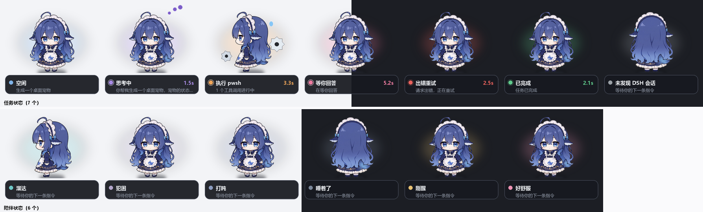

单文件 Python + Pillow，没有网络请求，没有遥测。它只读 DSH 自己写的会话文件，
不改配置、不装插件、不碰 DSH 本身。

## 🚀 跑起来

**方式一：直接用 exe（不用装 Python）**

下载 [Releases](../../releases) 里的 `DSH-Pet.exe`，双击就跑。
配置和相处记录会写在 exe 旁边。

**或者用安装包**：`DSH-Pet-Setup-x.y.z.exe` —— 带开始菜单项、桌面快捷方式和
卸载程序，安装时可勾选开机自启。自己编译安装包：

```bash
python build_exe.py
iscc installer.iss        # 需要 Inno Setup 6
```

**方式二：从源码跑**

```bash
git clone https://github.com/kmm331752-ai/dsh-pet
cd dsh-pet
python dsh_pet.py
```

需要 Python 3.10+ 和 Pillow。可选依赖两个：`pystray`（托盘图标）、
`numpy`（只在读 clawd 主题的 SVG 时才用得上）。

Windows 上双击 `启动桌宠.vbs` 可以静默启动，不弹控制台；
出问题就用 `调试启动.bat`，能看到报错。

**自己打包 exe：**

```bash
pip install pyinstaller
python build_exe.py        # 产物在 dist/DSH-Pet.exe
```

它会先用 `git archive` 导出已提交的文件再打包 —— 这样本地自用的受限素材
（比如被 `.gitignore` 排除的 clawd 主题）不会被塞进 exe 里分发出去。

```bash
python dsh_pet.py --demo                # 每 3 秒轮换状态，看效果用
python dsh_pet.py --list-skins          # 列出可用皮肤
python dsh_pet.py --skin kun-like       # 指定皮肤
python dsh_pet.py --session <id>        # 只盯一个会话
python dsh_pet.py --shot 前缀           # 不建窗口，把各状态渲成 PNG
```

左键点她一下会播个反应动画，顺便展开详情卡；拖动移动位置；右键是菜单。

## 🎭 任务状态（七种）

| 状态 | 什么时候 | 长什么样 |
|---|---|---|
| 🟦 空闲 | 没有任何会话在生成或跑工具 | 正面站着 |
| 🟪 思考中 | `sessionStats.openStep` 有值 | 正面 + 三个跳动的点 |
| 🟧 执行中 | `sessionStats.pendingCalls` 非空 | 侧面转身 + 转齿轮 |
| 🩷 等你回答 | `userQuestions.questions.active` 非空 | 正面 + 粉色光晕 |
| 🟥 出错重试 | `llmRetry` 非空 | 正面 + 红色光晕 |
| 🟩 已完成 | `turnBoundary.openTurnStartSeq` 从有值变 null | 庆祝动作 |
| ⬜ 离线 | 一个 DSH 会话都找不到 | 背面 |

（左边那些方块就是她脚下的光晕颜色）

优先级是 等你回答 > 出错 > 执行 > 思考 > 已完成 > 空闲。把「等你回答」排第一
是因为卡在你这里最该被看见 —— 其他状态再热闹，也不如这一条值得打断你。

「已完成」比较特殊：它不是某个字段的值，而是一次**变化**。盯着
`openTurnStartSeq` 从有值变成 null 的那一刻，就知道那个会话刚跑完一个回合，庆祝 6 秒。

## 🐾 陪伴模式

DSH 那边一个活跃会话都没有的时候，她不会傻站着显示「空闲」—— 她开始过自己的日子。

| 状态 | 什么时候 | 长什么样 |
|---|---|---|
| 🟦 溜达 | 白天有精神，随机触发 | 侧身走两步 |
| 🟪 犯困 | 45 秒没碰键盘鼠标 | 正面 + 紫色光晕 |
| 🟦 打盹 | 90 秒没互动 | 正面，动画放慢 3 倍 |
| ⬜ 睡着了 | 4 分钟没互动，或者深夜 | **背面**，缩成一团 |
| 🟨 刚醒 | 你动了鼠标 / 精力睡满 | 正面 + 暖黄光晕 |
| 🩷 好舒服 | 被摸 / 被喂 | 正面 + 粉色光晕 |

深夜（23:00–07:00）只要安静 30 秒就直接睡。你一碰键盘鼠标她就醒，
有时还会说一句「唔…醒了醒了」。

**她会记住你。** 相处记录存在 `pet_mood.json`：

- 陪你第几天、亲密度、精力
- 被戳 / 被拖 / 被喂各多少次
- 亲密度影响她的说法（「特别黏你」→「好久没理我了」）

**能对她做的事：**

| 操作 | 效果 |
|---|---|
| 左键单击 | 摸一下 —— 亲密度 +2%，精力 +5%，睡着会醒 |
| 拖动 | 也算互动，亲密度 +1% |
| 右键 → 喂一口 🍡 | 精力 +25%，亲密度 +6% |

偶尔她会自己冒一句话（文案表在 `dsh_pet.py` 顶部的 `WAKE_LINES` 那几个常量里，想改直接改）。

不想让她自己过日子的话，右键菜单或设置窗口里关掉「陪伴模式」就行，
也可以用 `--no-companion` 启动。

## 🖱️ 能对她做什么

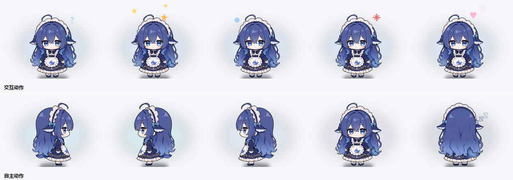

| 操作 | 她的反应 |
|---|---|
| **左键单击** | 摸一下 —— 亲密度 +2%，精力 +5%，头顶冒心；睡着会醒 |
| **鼠标停在她身上 1 秒** | 她注意到你，抬头冒一个「？」 |
| **拖动** | 移动位置，亲密度 +1% |
| **快速来回甩** | **晕头转向** —— 头顶转星星，持续 3 秒 |
| **按住不动 2 秒** | **把她抱起来** —— 她会挣扎冒汗，松手后**掉下去**落到屏幕底部 |
| **拖到屏幕边缘松手** | 她**抓住边缘**贴住不放 |
| **滚轮** | 缩放大小（60%~200%），设置会记住 |
| **双击** | 打开设置窗口 |
| **连续摸 5 次以上** | 她会**烦** —— 冒怒气符号说「别摸了…」，冷一会儿 |
| **右键** | 菜单：喂一口 🍡 / 展开详情 / 隐私模式 / 提示音 / 陪伴模式 / 皮肤 / 设置 |

**甩动**判定的是最近 0.6 秒内水平方向来回换了 5 次以上；**抱起来**是按住不动
2 秒（一移动就取消，所以不会跟拖动打架）。

这些装饰（星星、问号、心、怒气、汗、z）全是**程序化画出来的**，不依赖素材 ——
所以契约皮肤和 clawd 主题一样能用。

## ⌨️ 全局热键

| 热键 | 作用 |
|---|---|
| `Ctrl+Alt+P` | 显示 / 隐藏她 |
| `Ctrl+Alt+F` | 喂一口 |
| `Ctrl+Alt+D` | 专注模式开关（安静待机不冒泡） |
| `Ctrl+Alt+H` | 截图模式：连托盘一起藏掉，录屏时不碍事 |
| `Ctrl+Alt+S` | 打开设置 |
| `Ctrl+Alt+M` | 播放 / 暂停（在放歌时才有用） |

不想用可以 `--no-hotkeys` 启动。注册失败（比如被别的程序占了）只会在控制台
警告一句，不影响桌宠本身。

## 🍅 番茄钟

右键 → **番茄钟**，选 25 / 45 / 60 分钟。计时期间信息卡副行显示剩余时间
（`🍅 12:34`，用强调色），到点她会庆祝 + 响提示音 + 说一句。

**专注模式**（`Ctrl+Alt+D`）会让所有气泡静音，适合开会或录屏。

## 🧩 自定义台词

所有文案都在文件顶部，但不用改代码也能换 —— 在程序目录放一个 `pet_lines.json`：

```json
{
  "PET_LINES": ["嘿嘿", "再摸摸"],
  "FEED_LINES": ["谢谢投喂"],
  "YAWN_LINES": ["啊——欠", "老板什么时候下班"]
}
```

可用的键：`WAKE_LINES` / `SLEEP_LINES` / `YAWN_LINES` / `ROAM_LINES` /
`PET_LINES` / `FEED_LINES` / `ANNOY_LINES` / `DIZZY_LINES` / `GRAB_LINES` /
`HUNGRY_LINES` / `LONELY_LINES` / `MORNING_LINES` / `NIGHT_LINES` /
`EDGE_LINES` / `POMO_DONE_LINES`。

**只覆盖你写的那几个键**，其余继续用默认。值必须是**非空字符串列表**，
写错了会被忽略（不会让桌宠变成一句话都不说）。

## 📊 周报

右键 → **导出周报…** —— 最近 7 天干了什么，画成一张图存到程序旁边。

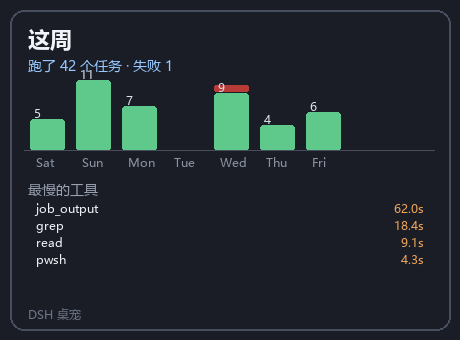

柱状图是每天完成的任务数（红色是失败的），下面是**最慢的五个工具**。

数据是平时攒的：每次任务完成/失败、每轮看到工具耗时就记一笔，
存在 `pet_mood.json` 里，**只留最近 30 天**（不然文件会无限长）。

没有数据也画得出来，只是会写「这周还没干什么」。

## 🪑 久坐 / 喝水提醒

连续用电脑太久她会提醒你起来动动，两个文案轮换。

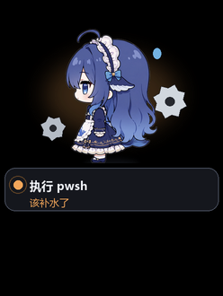

判据是**系统空闲时间**：空闲很短 = 人在用电脑，一直很短 = 久坐。
**走开超过 5 分钟就重置计时** —— 回来了重新算，不会追着人提醒。
已经闲了一会儿（超过 1 分钟）也不打扰，你可能在看手机。

默认 50 分钟提醒一次，启动后 45 分钟才开始算（别一开就念）。
常量在 `pet_sources.py`：`HEALTH_EVERY` / `HEALTH_FIRST` / `HEALTH_BREAK`，
`HEALTH_ON = False` 可以整个关掉。

> **踩过的坑**：这个提醒一开始挂在 `CompanionSource.poll()` 里，而那只在
> **DSH 空闲**时才被调用 —— 久坐恰恰发生在你干活的时候，等于「你越忙她越不提醒」。
> 实测：DSH 是 `tools` / `waiting` 时 `_health_check` 被调用 **0 次**。
> 当时的单元测试直接调 `_health_check`，完全没发现。现在它挂在 `_poll` 的末尾，
> 三条路径（demo / force_state / watcher）都经过。

## 🎨 皮肤预览

右键 → 皮肤 → **预览…** —— 所有皮肤排成九宫格，**点一下直接换**，
不用一个个试。

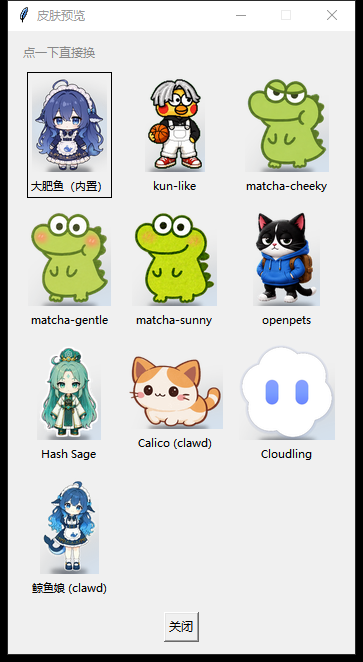

缩略图按角色本体裁掉空白再缩放，所以每格都是满满一张脸。
当前用的那套有边框。

长名字会在括号处断（`Hash Sage (clawd)` → `Hash Sage`），
不会切出「Hash Sage (cla」这种半截词。

## 🖱️ 会话操作

**点信息卡**（下半部分）打开会话操作窗口：

| 按钮 | 作用 |
|---|---|
| 打开日志 | 资源管理器定位到这个会话的日志文件 |
| 复制 ID | 会话 ID 进剪贴板 |
| 复制摘要 | 标题 · 状态 · 时长 · ID |
| 把 DSH 切到前台 | DSH 被桌宠压住时找不到，这个把它提上来 |

> **说明白一件事**：DSH **没有**「直接跳到某个会话」的接口 ——
> 它的 Web GUI 是个 SPA（没有服务端会话路由），CLI 只能启动 profile。
> 所以给的是能做的四件事，不是一键直达。复制 ID 后在 DSH 里搜是目前最顺的路子。

**点角色**仍然是摸她（和点信息卡分开，两件事的意图完全不同）。

## 🎛️ 什么情况播什么，现在是配置

原来图集皮肤的行号**写死在代码里**：

```python
ATLAS_ROW = {"idle": 0, "tools": 7, "thinking": 8, ...}
```

皮肤作者改不了。而 **clawd 主题本来就能自己映射**（`theme.json` 里的
`states` 段）—— 两种皮肤格式**不对称**。现在补上了。

### 两层（照 OpenPets 的分法）

```json
{
  "mapping": {
    "animations": {
      "idle":    { "row": 0, "durationMs": 5500, "loop": true },
      "running": { "row": 7, "durationMs": 820 }
    },
    "states": {
      "thinking": "review",
      "sleeping": "idle",
      "tools": "running"
    },
    "slowdown": { "sleeping": 4.5 }
  }
}
```

| 层 | 管什么 |
|---|---|
| `animations` | **动画定义** —— 名字 → 哪一行、多长、循环不循环 |
| `states` | **状态 → 动画** —— 你的状态该演哪个动画 |
| `slowdown` | 同一个动画，某些状态播得慢一点（打盹不该跟待机一样精神） |

分开的好处：**加一个动画不用动映射，改一个状态的对应不用动动画定义。**

### 三层优先级

```
内置默认  <  皮肤清单（pet.json / theme.json）  <  用户配置（pet_config.json）
```

- **皮肤作者**在 `pet.json` 里决定"这只宠物该怎么演"
- **用户**在 `pet_config.json` 里写 `mapping` 盖在皮肤之上

**只盖显式写过的键** —— 你只想改"睡觉播什么"的时候，不会把皮肤作者
配的另外十几项一起清掉。

### 界面里也能改

设置窗口最下面有 **「动画映射（什么情况播什么）…」**，打开是这样的：

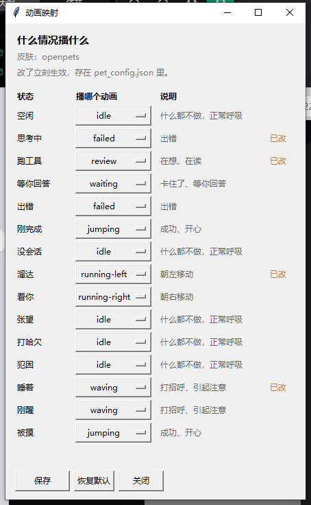

15 个状态各一个下拉框，右边跟着说明。**改过的行标「已改」**，
一眼看得出哪些动过。有「恢复默认」和「保存」。

**只存改过的那些** —— 15 个全写进配置的话，以后我们改默认值就传不到
你那儿了。

### 写坏了不会炸

`pet.json` 是手改的文件（记事本存 BOM 这种事踩过）。所以坏配置是
**降级 + 记警告**，不是抛异常：

- 行号超出图集 → 忽略这一项，用默认
- 指向不存在的动画 → 忽略，用默认
- 整段不是对象 → 忽略整段

被忽略的项会打到 stderr，也能从 `mapping_warnings()` 拿到。

### 可选项一览

`animations` 的名字沿用契约的行名（`idle` / `running-right` / `waving` / …），
认识契约的人一看就懂。`states` 的可用值就是上面那张状态表。

## 🐾 她也能在 OpenPets 里跑

[**OpenPets**](https://github.com/OpenPetsHQ/openpets)（1305★，**MIT**）是一个
跨平台桌宠平台 —— Windows / macOS / Linux，自带安装包、自动更新、插件市场。

**你的角色已经能在里面跑** —— 因为 OpenPets 的皮肤契约和本项目的皮肤契约是
同一个：`spritesheet.webp` + 可选 `theme.json`。

```
assets/skins/openpets/
  ├─ pet.json            ← OpenPets 的包清单（必填，少了导不进去）
  └─ spritesheet.webp    ← 1536×2288 = 8 列 × 11 行，每帧 192×208（V2 契约）
```

> **补这个 `pet.json` 之前，「作为分发渠道保留」这句话其实是空的** ——
> 目录里只有 `spritesheet.webp`，而 OpenPets 要清单才认。
> 现在有测试守着这四个必填字段、图集尺寸和 `gazeAnchor` 的合法性。

### 怎么用

1. 装 [OpenPets Desktop](https://github.com/OpenPetsHQ/openpets/releases)
2. 把 `assets/skins/openpets/` 整个目录作为宠物包导入
3. 她就在 OpenPets 里跑了

（本项目自己也能加载同一个目录 —— 两条路共用一份图集。）

### 为什么要留这条

**两个产品做的事不一样，不冲突**：

| | 本桌宠 | OpenPets |
|---|---|---|
| DSH 任务状态 | ✅ 这是它存在的理由 | ❌ |
| 音乐交互（SMTC） | ✅ 读 + **反向控制** | ❌ 插件沙箱碰不到 Win32 |
| 前台应用感知 | ✅ 零依赖 ctypes | ❌ 同上 |
| 跨平台 | 只做了 Windows 快路径 | ✅ 三平台安装包 |
| 自动更新 / 插件市场 | 自己的 | ✅ 现成的 |

**关键区别**：OpenPets 的插件跑在**沙箱化的 BrowserWindow** 里，碰不到
Win32 —— 所以**音乐交互和前台感知这两块它做不到**，只能自己写。

> 这也是为什么主产品必须是自己的：你要的那两块，正好是沙箱做不到的部分。

而**皮肤那条是白捡的** —— 契约已经兼容，不用额外做什么，就当多一个曝光渠道。

## 🐾 宠物库（petdex）

设置窗口 →「宠物库（从 petdex 找一只来养）…」

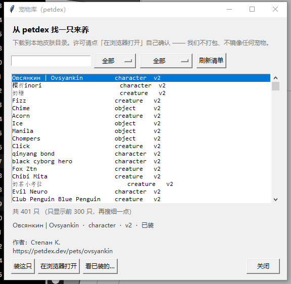

[petdex](https://github.com/crafter-station/petdex) 有 **5000+ 只** Codex 宠物。
搜名字、按类型筛（角色/生物/物件）、按版本筛（**v2 才有 16 方向视线**），
点「装这只」下到本地皮肤目录，就能在「皮肤」里选它。

### ⚠️ 关于许可 —— 我们不打包任何宠物

petdex **不暴露单只宠物的许可**。查过：

| 位置 | 有没有许可 |
|---|---|
| `/api/manifest` | ❌ 只有 slug / 名字 / 类型 / 图 URL |
| `/api/pets/<slug>` | ❌ 要鉴权（401） |
| 下载下来的 `pet.json` | ❌ 只有 4 个必填字段 |
| 宠物页面上的 "License" | ❌ 那是**提交表单的 i18n 文案**，不是这只的值 |

而它接受的许可有五档，**三档和本项目的 MIT 冲突**：

| 许可 | 能用吗 |
|---|---|
| `cc0` | ✅ 公共领域 |
| `cc-by` | ✅ 署名即可 |
| `cc-by-sa` | ❌ **相同方式共享**（病毒式，和 MIT 冲突） |
| `cc-by-nc` | ❌ 仅非商用 |
| `all-rights-reserved` | ❌ 根本没授权 |

**所以这个功能是"客户端"，不是"内置一批"**：你自己搜、自己选、自己下到本地。
界面给每只宠物一个「在浏览器打开」按钮，**许可你自己确认**。

和当初排除 Hash Sage / Whale-chan 是同一条线 —— **权利说不清的东西不进仓库。**

### 装的时候会验

装之前验图集尺寸（宽必须 1536、高必须是 208 的整数倍且 ≥ 9 行），
不合格的直接拒掉 —— 不然皮肤列表里会多一个点了就崩的坏项。

先下到 `.part` 临时目录再原子搬过去，**下到一半失败不会留半截皮肤**。
「看已装的…」里可以删，只认 `petdex-` 前缀，手滑传错名字不会删掉你自己的皮肤。

---

## 🎭 更多交互

补了三个**原来完全没有反馈**的情况：

| 情况 | 原来 | 现在 |
|---|---|---|
| **滚轮缩放** | 直接改大小，零反馈 | 被拉扯的弧线和箭头 |
| **睡着时被戳** | 和醒着被戳一模一样 | 黄色感叹号 + 惊醒的台词 |
| **喂食** | 借的是「被戳」动画，看不出在吃 | 嘴边飘食物碎屑 |


**到最大/最小了再滚不会抖** —— 滚到底是常见动作，每次都抖会很烦。

睡着被戳说的是另一套台词（`STARTLE_LINES`：*"吓我一跳" / "干嘛呀，人家在睡"*），
和醒着被摸分开 —— 被弄醒和被摸是两件事。

## 👀 她会看着你的鼠标（16 个方向）

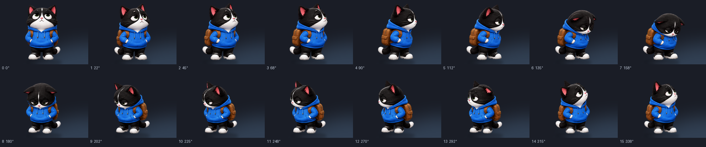

**不是左右翻转，是整个人转过来。** 鼠标在哪儿她转向哪儿，360° 无死角。

> **素材本来就在图里，我们一直没用。**
>
> Codex / OpenPets 的图集契约 v2 是 **8×11**，比 v1 多的**第 9、10 行
> 不是动画，是 16 个视线方向格子**。而代码里写着 `ATLAS_ROWS = 8, 9` ——
> 只认 9 行。于是 11 行的图**通过了校验**，后两行**从来没被播过**，
> "看向鼠标"只用 `mirror` 翻转（2 个方向）。
>
> 规格来自 OpenPets 的 `apps/desktop/src/codex-pets-core.ts`：
> 16 扇区、死区 24px、鼠标停 1.2 秒回中性、中性姿势是 `row 0, col 6`。

| 行为 | 说明 |
|---|---|
| 鼠标移动 | 16 个方向实时跟随 |
| 鼠标离她很近（24px 内） | 回中性姿势，不斜眼 |
| 鼠标停 1.2 秒 | 回中性（一直盯着看像卡住了） |
| 拖动她的时候 | 不跟随（手在哪儿她跟着看很怪） |
| 水平翻转时 | 自动镜像方向索引，翻过来才是对的 |

**皮肤要支持才有** —— 图集是 v2（11 行）且后两行有内容。内置的大肥鱼皮肤是
程序化画的，没有这些格子，会自动跳过（行为跟以前一样）。

`gazeAnchor` 从皮肤的 `pet.json` / `theme.json` 读，没有就用底边中点。

## 🎵 她听得见你在放什么


放歌的时候，她头顶会飘音符（暖色，三个，错开相位），信息卡显示歌名。

**用的是一条系统级接口，不是一家家对接**：

| 播放器 | 支持 |
|---|---|
| QQ 音乐 | ✓ 需 ≥ 21.10.2962，且要在 **设置 → 常规 → 通知 → 显示系统媒体传输控件** 里打开 |
| 网易云音乐 | ✓ 较新版本支持；**UWP 版兼容性更好** |
| 酷狗 / 酷我 | ✓ |
| Spotify / Apple Music | ✓ |
| 浏览器（YouTube 等） | ✓ |

Windows 的 **SMTC**（System Media Transport Controls）是系统级媒体会话。播放器把自己
发布上去，任何程序都能读到曲名/歌手/专辑/进度，**还能反过来控制播放**。

不用 OAuth，不用一家一家写适配 —— 比对接各家 API 省事一个数量级。

### 依赖很小

```bash
pip install winrt-runtime winrt-Windows.Foundation \
            winrt-Windows.Foundation.Collections \
            winrt-Windows.Media.Control winrt-Windows.Media.Core \
            winrt-Windows.Media.Playback winrt-Windows.Storage
```

**用模块化的 `winrt-*`，不是单体的 `winsdk`**：

| 方案 | 体积 |
|---|---|
| `winsdk`（单体） | 41.7 MB（`_winrt.pyd` 一个就 37.6 MB） |
| **`winrt-*`（模块化）** | **4.8 MB** |

功能一样（读元数据、读时间轴、控制播放都实测过），**差 8.7 倍**。

**没装也能跑** —— 音乐相关的功能安静地不出现，其他一切照常。

### 怎么控制

| 入口 | 做什么 |
|---|---|
| 右键菜单 → ⏯ / ⏭ / ⏮ | 播放暂停 / 下一首 / 上一首（**没在放歌时自动灰掉**） |
| 右键菜单 → 现在在放什么… | 曲目、来源、进度条，还能从那儿控制 |
| 托盘图标 → 播放 / 暂停 | |
| **Ctrl+Alt+M** | 播放 / 暂停 |

切歌的时候她会**播一下反应动画**（复用"戳一下"那套素材，
没有这个反应的皮肤会自动跳过）。

### 手动验一下

```bash
python tools/probe_music.py
```

它会先报「现在系统里在放什么」，然后自己发布一个测试会话验证整条链路。
**这个必须是手动的**：真 SMTC 读的是"此刻这台机器上在放什么"，
写进自动化测试就等于让测试依赖机器状态（踩过，见 AGENTS.md 规则 6）。

## 👀 她知道你在用什么软件

**零新依赖** —— 全是 `ctypes` 调 Win32 基础接口（这个项目本来就在用 ctypes）。

她按你在干什么决定**该不该出声**：

| 你在 | 她 |
|---|---|
| 开会 / 视频通话 | **绝对安静**，一句话都不冒 |
| 写代码 | 安静待着，不弹话（但你碰她她还是会回应） |
| 看视频 / 玩游戏 | 陪着，不打扰 |
| 同一个应用待太久 | 提醒你起来动动 |

认出 9 类应用：coding / browsing / video / music / meeting / game / chat / design / office。

### 隐私

**只读进程名和窗口标题，不记录、不落盘、不联网。**

窗口标题可能有敏感信息（文档名、聊天对象），所以它**只在内存里**用来分类，
**绝不写进 `pet_mood.json`** —— 有一条测试专门守这个。

## 🔌 没有 DSH 也能用

DSH 只是她的**数据源之一**，不是前提。

- **有 DSH** → 她显示任务状态（思考中/跑工具/等你回答…）
- **没有 DSH** → 她自己过日子：溜达、看你、打盹、听歌、按你在忙什么决定安不安静

实测：把 DSH 路径指向空目录，App 正常启动、自动进陪伴模式、状态从 `offline`
变成 `gazing`（她在看你）。


右键 → **喂她吃点什么** —— 12 种食物，点一下喂。

## 🍡 喂她吃点什么

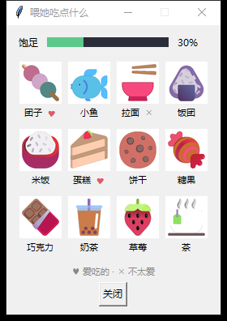

**她有自己的口味**：开新档时随机挑 2 个最爱（♥）和 1 个不爱吃的（✕），
之后**一直不变** —— 这样她是「这一只」，不是每次都一样的通用宠物。

| | 精力 | 饱足 | 亲密 |
|---|---|---|---|
| 正餐（拉面 / 饭团 / 米饭） | 高 | **高** | 低 |
| 零食（糖 / 巧克力 / 饼干） | 低 | 低 | 中 |
| 甜点（蛋糕 / 团子） | 中 | 中 | **高** |
| 茶 | 最低 | 最低 | 低 |

- **最爱**：亲密 ×2，精力 ×1.2，但**不会更顶饱** —— 爱吃不代表更管饱
- **不爱吃**：什么都打 4 折，但还是能吃，只是不情愿
- **吃饱了就拒绝**：饱足到 92% 她会说「吃不下啦」，这一口不算数

### 饱足和精力是两回事

原来只有 `energy` 一个值兼着当饥饱 —— 于是「喂饱了」和「精神好」变成同一件事，
说不通：她可以又累又饱，也可以又饿又精神。

现在分开：**精力**睡觉回、醒着掉、喂食也回一点；**饱足**只靠吃涨，
随时间掉（约 40 分钟从满到空），**睡着也在消化**。

### 素材

食物图标来自 [microsoft/fluentui-emoji](https://github.com/microsoft/fluentui-emoji)，
**MIT 许可**。挑它是因为干净 —— 对比过 OpenMoji（CC-BY-SA，SA 有传染性，
和本仓库的 MIT 冲突）、Twemoji（代码 MIT 但美术 CC-BY 4.0）。
详见 [assets/ATTRIBUTION.md](assets/ATTRIBUTION.md)。

重新拉：`python tools/fetch_food.py`

## 📤 导出相处记录

右键 → **导出相处记录…**，在程序目录生成 `相处记录.png`：陪了几天、
亲密度进度条、被摸/被拖/被喂次数。可以直接发出去。

## 🔔 自动更新

右键 → **检查更新…**，后台查一次 GitHub Releases（不阻塞界面、不自动下载）。
有新版本她会说一句「有新版本 v1.2.0」，控制台也会打印下载地址。

网络不通或限流都只算「查不到」，绝不会因此报错或影响启动。

## 🎵 音效

不同事件响不同的系统音（不占体积，换系统主题时音效也跟着变）：

| 事件 | 系统音 |
|---|---|
| 任务完成 | `SystemAsterisk` |
| 出错 | `SystemHand` |
| 等你回答 | `SystemExclamation` |
| 番茄钟到点 | `SystemNotification` |

**想换成自己的音效**：在程序目录建 `sounds/`，放 `<事件>.wav`（事件名就是上表左列）：

```
sounds/done.wav
sounds/failed.wav
sounds/pomo.wav
```

同名文件存在就用你的，不存在就退回系统音。同一种音 3 秒内只响一次
（多个任务同时完成不会连响），但不同事件各算各的。

## 🖥️ 高 DPI

程序启动时声明 **PerMonitorV2** DPI 感知，窗口尺寸按系统缩放倍数放大 ——
4K 屏 200% 缩放下不会糊，也不会只有半个手掌大。老系统自动退回
System DPI 感知，再不行就不声明（模糊但能用）。

## 🎩 配饰

右键 → **配饰**，八种随便换，独立图层，**所有皮肤通用**：

| | | | |
|---|---|---|---|
| 尖顶帽 | 鸭舌帽 | 小皇冠 | 蝴蝶结 |
| 眼镜 | 耳机 | 围巾 | 不戴 |

程序绘制的，不占体积，跟着角色缩放走。位置是**量出来的**不是猜的 ——
从帧里用 alpha 阈值找出角色本体（排除光晕和落影），再按比例定位，
所以换皮肤也不会错位。

## ⏰ 她会学你的作息

不需要读键盘记录 —— **DSH 有活在跑就说明你在**。她按小时记 24 个格子，
攒够了就能看出你几点在、几点不在：

```
上班族: 0░░░░░░░░░██████████░░░░░23     █ 常在   ▒ 有时在   ░ 通常不在
夜班:   0██████░░░░░░░░░░░░░░░░██23
```

学到之后会**推翻钟点判据**：夜班的人凌晨 3 点还在干活，那对她来说就不算深夜，
不会一到 23:00 就犯困。

门槛是**每个钟点各攒 30 个样本**（至少 6 个钟点够了才画图）——
不是按总样本数，那样 42 秒就"学会"了，什么都说明不了。

设置窗口里能看到当前的作息条。

## 💬 本地对话（可选）

右键 → **和大肥鱼说话…**，或者设置窗口里的按钮。

走标准 **OpenAI 兼容接口**，所以 Ollama / LM Studio / llama.cpp / vLLM / LocalAI
都能用，不绑定任何一家。

**⚠️ 需要你自己装一个本地模型** —— 这个功能默认是关的，没配就只是告诉你没配。

```
1. 装 Ollama：https://ollama.com/download
2. ollama pull qwen2.5:3b          （3B 就够，桌宠聊天不需要大模型）
3. 右键 → 设置 → 本地对话 → 地址填 http://127.0.0.1:11434
4. 点「测试连接」，它会列出可用模型，只有一个的话自动填上
5. 点「保存」
```

地址怎么写都行 —— `127.0.0.1:11434`、`http://127.0.0.1:11434/v1`、
甚至整个 `.../v1/chat/completions` 都会被归一。

她的人设是**她自己的口吻**（短句、口语、有点黏人），不是通用助手。
而且会带上背景 —— 你在忙什么、认识多少天 —— 好接得上话。
回复会截到 120 字（气泡放得下），保留 8 轮上下文。

想换人设改 `pet_chat.py` 里的 `PERSONA`。

## 🌐 语言 / Language

右键 → 设置 → **语言**，三选一：**跟随系统 / 中文 / English**。

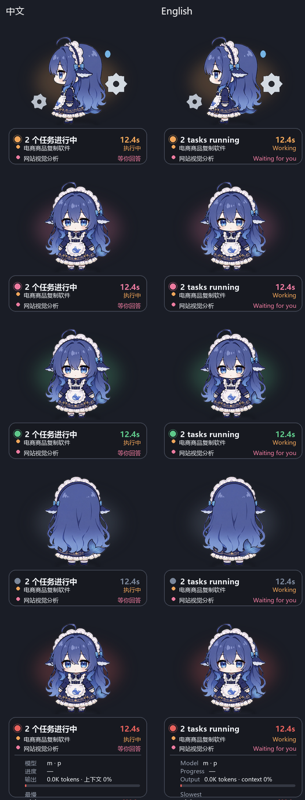

`跟随系统` 按 Windows 的界面语言判断（中文系统用中文，其余用英文）。

**界面、状态标签、台词、信息卡全部翻译** —— 只有你的任务标题保持原样
（那是你的数据，不该翻）。

想加第三种语言：在 `pet_i18n.py` 的 `EN` 旁边加一个表，再把 `LANGS`
和 `LANG_LABELS` 补上就行。翻译表**以中文原文为 key**，所以不用为了
翻译去改源码里的字面量；没翻到的句子自动退回中文，不会出现空白。

有两条测试守着完整性：翻译表里不能有源码里不存在的孤儿 key，
源码里 `t()` 包住的每一句也都要有翻译。

## 🏃 她会自己做什么

| 动作 | 什么时候 |
|---|---|
| **看向鼠标** | 鼠标在附近动过，且离她 90px 以上 → 她转头朝那边（会镜像翻转） |
| **溜达** | 白天精力够，随机每 35~90 秒走两步 —— **窗口真的会移动** |
| **换显示器** | 溜达时约 1/8 概率跑到另一块屏幕 |
| **探头** | 每 2~5 分钟，侧身探头看一会儿 |
| **犯困 / 打盹 / 睡着** | 闲置 45s / 90s / 240s（深夜 30s 直接睡） |
| **数羊** | 睡着时头顶飘 z z z |

**情绪与情境：**

| 触发 | 反应 |
|---|---|
| 精力低于 22% | 主动要吃的：「有点饿了…」 |
| 超过 2 小时没互动 | 叹气「好久没理我了」，亲密度缓慢下降 |
| 早上 5~11 点 / 晚上 22 点后 | 各问候一次：「早啊」/「还不睡？」 |
| 陪满 7 天 | 解锁一句：「我们认识 7 天啦」 |

## ⚙️ 设置窗口

右键菜单 → **设置…**，或者改配置文件。里面有：

- 陪伴模式 / 开机自启 / 隐私模式 / 提示音 四个开关
- 皮肤下拉选择
- 相处记录一览 + 「重置相处记录」按钮
- 「位置复位」按钮（窗口跑到屏幕外时用这个）

**开机自启**写的是 `HKCU\Software\Microsoft\Windows\CurrentVersion\Run`，
不需要管理员权限。打包成 exe 之后自启的就是 exe 本身。

**多显示器**：位置按绝对坐标记，拔掉副屏之后如果窗口落到已经不存在的区域，
启动时会自动夹回可见范围（至少留 60px 让你能抓住它）。

## 📋 多个会话

一个 DSH 会话算一个任务。桌宠每轮扫描全部会话，把在跑的挑出来排序后全列出。

角色显示的是**聚合状态** —— 只要有一个任务在跑工具，她就转身拿齿轮。
折叠的信息卡里，单任务显示状态、工具名和耗时；多任务显示「N 个任务进行中」，
下面逐行列出每个任务的标题、状态、耗时。展开详情面板还能看到主任务的模型、
token 和上下文占用。

排序按「状态优先级，同类按开始时间」，所以顺序是稳的，不会来回跳。

## 🎨 皮肤

仓库带六套，右键菜单切换：

| 皮肤 | 来源 | 格式 |
|---|---|---|
| 大肥鱼 | 内置 | 三视图 + 程序化姿态 |
| kun-like | [dsh-kun-like-pet](https://github.com/liyupi/dsh-kun-like-pet) | Codex 契约 |
| openpets | [openpets](https://github.com/OpenPetsHQ/openpets) | Codex 契约（11 行扩展） |
| matcha-cheeky / gentle / sunny | [MatchaDandan](https://github.com/CaptainRong/MatchaDandan) | Codex 契约（11 行扩展） |

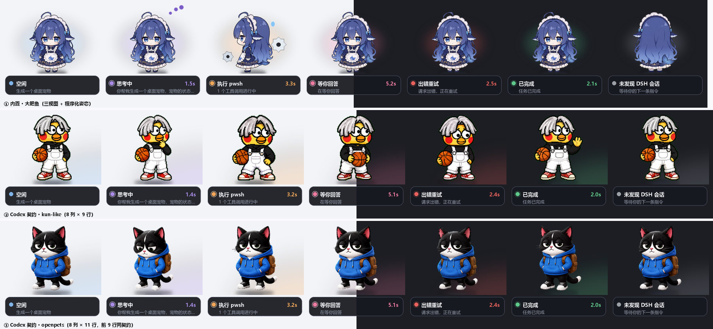
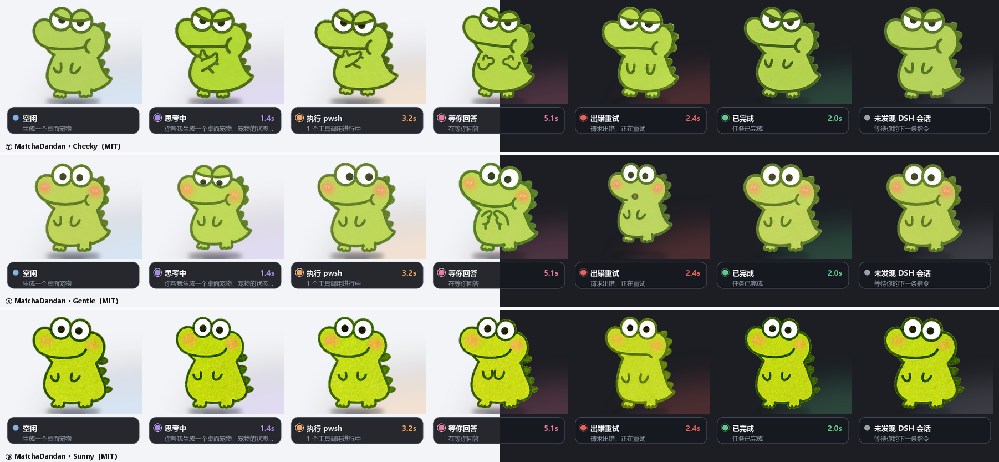

六套的授权都是 MIT 或等价宽松许可，可以放心用 ✅

### ➕ 加自己的皮肤

支持两种格式，都是丢进目录就能认，不用改代码。

**Codex 桌宠精灵图契约** —— 一张图集，单格 `192×208`，8 列、至少 9 行。
行序是固定的：待机、向右跑、向左跑、挥手、跳跃、出错、等待回复、专注干活、思考审阅。
第 9 行往后随便加，openpets 就多画了两行。

```
<程序目录>/assets/skins/<名称>/spritesheet.webp
~/.codex/pets/<名称>/spritesheet.webp        ← Codex 桌宠自己的目录
```

**clawd 主题** —— 目录顶层放 `theme.json`，资源在 `assets/` 下，
每个状态一个文件（`.apng` / `.gif` / `.webp` / `.png` / `.svg` 都行）。

```
<程序目录>/assets/skins/clawd/<名称>/
%APPDATA%/clawd-on-desk/themes/<名称>/       ← clawd 自己的主题目录
```

clawd 的状态名会映射到本项目的状态：`idle`/`dozing`/`yawning` → 空闲，
`thinking`/`sweeping` → 思考中，`working`/`carrying`/`juggling` → 执行中，
`attention`/`notification` → 等你回答，`error` → 出错，`sleeping`/`collapsing` → 离线。

APNG、GIF、WebP、PNG 走 Pillow，动画完整，逐帧时长也读得到。
静态 SVG 会先光栅化再用。

**不想手动解压？** 右键 → 皮肤 → **从链接安装…**，填一个 zip 的 URL
或者本地路径，下载、解压、校验、装上一步到位，装完直接切过去。

安装器会自己判断压缩包里哪一层是皮肤根（套一层两层目录都认得），
装完还会**重新扫一遍确认认得出来**，认不出就回滚删掉 —— 不会留下
半个坏皮肤让桌宠下次启动时崩。

压缩包里的路径穿越（`../../`）、绝对路径、压缩炸弹都会被拒绝。
装错了想删：皮肤 → **删除皮肤…**（内置的三套删不掉）。

⚠️ **脚本驱动的 SVG 只能拿到静止帧。** clawd 的不少 SVG 是 JS 在运行时算动画的
（cloudling 自己管这叫 "scripted SVG object-channel assets"），光栅化只截得到一帧。
实测 cloudling：云朵、眼睛、出错态的 X 眼都在，但打字的手之类就没了，几个状态只剩一团云。
Calico 不受影响 —— 它只有 idle 用 SVG，而且是眼球追踪用的 `-follow.svg`，
加载器会自动换成同名的 APNG，动画是完整的。

### ⚖️ 仓库里为什么没有 clawd 的素材

加载器在（是代码，MIT），素材一套都没打包。原因都是授权，不是技术：

- 🚫 **calico / cloudling** 的美术权利状态**未明确**。上游源码是 AGPL-3.0，
  但 README 明说该许可不自动适用于美术，也没给这些美术单独授权。
  本地自用没问题，公开再分发就是另一回事了。
- 🚫 **鲸鱼娘** 是 CC BY-NC-SA 4.0，允许非商业移植，但 SA 有传染性 ——
  会要求整个衍生作品都用同样的许可发布，跟本仓库的 MIT 冲突。它还有 157MB。
- 🚫 **哈希仙人** 保留全部权利，许可里明确写了不许 `use these materials in another project`。

所以你自己放主题进去就行，上面两种目录都可以 ✅ 完整说明在
[ATTRIBUTION.md](assets/ATTRIBUTION.md)。

## 🕶️ 隐私模式

跟 [openpets](https://github.com/OpenPetsHQ/openpets) 学的：**气泡里不放提示词、代码和路径**。

开着的时候，任务行标题从会话标题（由你的提问生成）变成「会话 1」「会话 2」，
副行文案也从提示词片段变成「模型正在生成」这种通用说法。
右键菜单或 `--privacy` 切换，记在 `pet_config.json` 里。

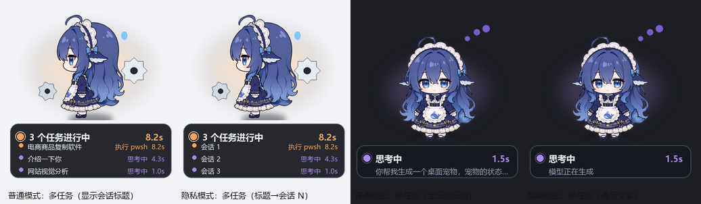

## 🔔 托盘和提示音

桌宠被窗口挡住时，托盘图标仍然显示当前状态（图标就是该状态首帧缩到 64px，
悬停能看到状态名）。任务跑完会响一声系统提示音，多个任务同时完成只响一次。

两个都能在右键菜单里关掉。

## 🔍 状态是怎么读到的

只读两份 DSH 自己写的文件。

**会话投影缓存**（主要来源，明文 JSON）：

```
<DSH_HOME>/storages/session_projcache/sessions/session-<id>.json
```

`rows` 下面那些字段就是判断依据 —— `sessionStats.openStep` 非 null 说明在生成，
`pendingCalls` 非空说明有工具在跑，`userQuestions.questions.active` 非空说明在等你，
`llmRetry` 非空说明在重试，`turnBoundary.openTurnStartSeq` 由有转无说明刚跑完。
另外还读了 `title`、`turnOutline`、`modelSelection`、`contextPressure`、
`tokenUsage`、`plan`、`goal` 这些用来填详情面板。

**会话事件日志**（只为了拿工具名）：

```
<DSH_HOME>/sessions/*/session-<id>/session*.jsonl.zstd
```

这是追加写的 zstd 流，Python 没法一直挂着解压流读（`decompressobj` 不能复用，
`stream_reader` 也读不到后面追加的数据）。所以按 zstd 帧魔数 `28 B5 2F FD` 切开，
一帧一帧独立解，只解上次之后新增的那些 —— 每轮开销恒定，跟日志总长无关。
从 `tool/call` 事件里取 `callId → name`，就能把 `pendingCalls` 里的 ID 还原成
`pwsh`、`read`、`grep` 这种工具名。

投影缓存按 mtime + size 缓存，文件没变就不重新解析。实测 10 个会话下，
一轮轮询中位 0.8ms、最差 14ms，轮询间隔是 350ms，很宽裕。
工具名的增量读取器只给活跃会话建，最多留 6 个，不会去读遍所有日志。

## 🕳️ 实现上踩过的坑

**透明窗口。** tkinter 自己做不了逐像素透明，所以用 `WS_EX_LAYERED` +
`UpdateLayeredWindow` 直接推一张带 alpha 的 32 位位图。这样边缘是平滑的，
而不是 `-transparentcolor` 抠色那种带色边的效果。

两个坑：

- `UpdateLayeredWindow` 的 `pptDst` 参数**会移动窗口**。传坐标进去的话每帧都把窗口
  搬到那儿，Tk 设的 `geometry` 全被覆盖 —— 必须传 `NULL`。
- 预乘 alpha 别用 Python 逐像素循环，每帧五万次迭代太慢。用 `ImageChops.multiply`
  逐通道乘，再让 PIL 以 `"BGRA"` 原始模式吐字节。

**动画。** 素材只有三张静态三视图，动感全靠变换：呼吸（纵向缩放）、弹跳、轻微旋转、
状态光晕、配件旋转。所有帧预渲染后缓存，每帧只做合成和推送，CPU 占用很低。

万一分层窗口不可用，会退回 `-transparentcolor` 并打条警告。

## 📁 文件

| 路径 | 是什么 |
|---|---|
| `dsh_pet.py` | 主程序：`PetApp`（窗口 + 交互）和命令行入口 |
| `pet_base.py` | 路径、常量、Win32 分层窗口、字体、几何、出错日志 |
| `pet_types.py` | `TaskInfo` / `Snapshot` |
| `pet_render.py` | 角色渲染、叠加图形、皮肤、信息卡 |
| `pet_sources.py` | 读 DSH 会话日志、状态监视、陪伴行为、台词表 |
| `pet_system.py` | 全局热键、更新检查、开机自启 |
| `pet_skin_install.py` | 皮肤安装（下载 / 解压 / 校验 / 回滚） |
| `pet_accessories.py` | 配饰：程序绘制的帽子围巾等独立图层 |
| `pet_chat.py` | 本地对话：OpenAI 兼容客户端 |
| `pet_i18n.py` | 多语言：以中文原文为 key 的翻译表 |
| `build_exe.py` | 打包脚本，产出 `dist/DSH-Pet.exe` |
| `installer.iss` | Inno Setup 安装包脚本（`iscc installer.iss`） |
| `tests/` | 三层回归测试，直接 `python tests/xxx.py` 跑 |
| `assets/` | 角色三视图，以及 `skins/` 下的契约皮肤包 |
| `dsh-plugin/` | DSH 插件（可选，见下） |
| `启动桌宠.vbs` / `调试启动.bat` | 静默启动 / 带控制台启动 |
| `preview/` | 各状态渲染图和实机截图 |
| `pet_config.json` | 窗口位置与偏好（运行时生成，已在 .gitignore 里） |
| `pet_mood.json` | 相处记录：亲密度、精力、互动次数、周报统计（同上） |
| `pet_lines.json` | 可选，自定义台词（同上） |
| `周报.png` / `相处记录.png` | 导出的图（同上） |
| `.github/workflows/` | CI：push 跑三层测试；打 tag 自动构建 exe + 安装包并发 Release |

模块之间是单向依赖：`base → types → render / sources / system → dsh_pet`。
`import dsh_pet` 会把所有符号带出来，所以老用法不变。

## 🧪 测试

```bash
python tests/test_pet.py        # 108 项单元测试，7 秒
python tests/test_smoke.py      #  28 项冒烟测试，真的把 PetApp 建起来
python tests/test_e2e.py        #  19 项端到端测试，配置 → 屏幕像素
```

不需要 pytest，直接跑就行。

### 三层，各拦一类坏法

| 层 | 测什么 | 拦住的坏法 |
|---|---|---|
| **单元** | 零件（函数输入输出） | 逻辑错 |
| **冒烟** | 能不能起来、窗口和对话框在不在 | 启动即崩、点了没反应 |
| **端到端** | **整条路**：写配置 → 建 App → 跑一轮 → 看推给屏幕的像素 | 零件都对、路走不通 |

**端到端这一层是补出来的**，因为前面两层漏过两次：

- **配饰那个 bug** —— 当时直接调 `draw_accessory()` 验证它画得出来，通过。
  但真实路径上有两个 bug（配置被 BOM 吞掉、绘制污染缓存），**一个都没测到**，
  最后是用户发现的。
- **多语言那个 bug** —— 测试只查「`t()` 包住的有没有翻译」，
  而**根本没包**的信息卡不在检查范围里。截图才看出来。

核心工具是 `capture(app)`：截获 `display.push` 收到的画布，那就是用户真正看到的东西。

```python
def test_config_reaches_the_screen(self):
    self.write_config(accessory="hat")     # 1. 写配置
    app = self.make_app()                  # 2. 真建 app
    canvas = self.capture(app)             # 3. 真跑一轮，截屏
    assert 头顶有变化                        # 4. 断言像素
```

**两个装置上的坑**（第一版都踩了）：时间要冻住（动画帧按墙钟选，两次截图对不上，
会误判成「配饰没关掉」）；`_poll` 要能关（它会用 DSH 状态覆盖手工塞的 snapshot）。

副作用控制：临时目录当配置目录，托盘从 `sys.modules` 摘掉（不弹图标、不起线程）。

CI 在 Windows + Python 3.10/3.12 上跑这三套，push 和 PR 都触发。
发版时再跑一遍，**测试不过就不发**。

### 📌 要改这个仓库的话，先看 [AGENTS.md](AGENTS.md)

那份文件是**踩坑记录**，不是风格指南 —— 每条规则后面都挂着真实事故。
排第一的是：

> **加功能，默认先写一条走 `_poll` 的测试。**

因为同一个错误犯了两次：测试直接调内部函数（`draw_accessory()`、
`_health_check()`）都通过，但真实调用路径上有 bug —— 配饰被 BOM 吞掉配置、
久坐提醒挂在只在 DSH 空闲时才跑的 `poll()` 里。**两次都是用户发现的。**

## 🔌 DSH 插件（可选）

`dsh-plugin/` 里有个 DSH 插件，作用是**随 DSH 启动自动拉起桌宠**，
以及在侧边栏底部加一个开关按钮。

**目前只有 Host 半能用** ⚠️：自动启动没问题，`/dsh-pet/status` 和 `/dsh-pet/toggle`
两条路由实测正常。但**侧边栏那个按钮没出现**，还在查 —— 怀疑是本包没被扫进
客户端模块图，需要看 `window.__DSH_BOOT__` 才能确认。插件里留了条
`/dsh-pet/debug-boot` 路由专门用来查这个。

桌宠自己带单实例锁（绑本地端口 51937，进程退出由系统释放），
所以插件、快捷方式、手动启动三条路随便走，不会叠出两只。

安装方式见 [dsh-plugin/cordis.patch.yml](dsh-plugin/cordis.patch.yml) 里的注释
（Electron 桌面版独占管理 profile，`dsh plugin add` 会被拒，得手工链接）。

不用插件也完全没关系，双击 `启动桌宠.vbs` 一样跑 👌

## ⚠️ 已知限制

**状态有 3~5 秒延迟。** DSH 的投影缓存不是工具一发就更新：

```
t=0.0s  pendingCalls={}                  openStep=step 71   ← 工具已经在跑了
t=2.5s  pendingCalls={}                  openStep=step 71   ← 投影还是没更新
t=5.0s  pendingCalls={call_00_ecsx...}   openStep=None      ← 这才切到「执行中」
```

所以短于 5 秒左右的工具调用可能捕捉不到，桌宠会一直显示「思考中」。
这是读投影缓存的固有限制，不是渲染的问题。

**只看本机。** 读的是本地 DSH 数据目录，远程或容器里的 DSH 看不到。

**一个会话 = 一个任务。** DSH 投影缓存里的 `subagentCatalog` 基本是空的，
后台任务更是完全没暴露，所以同一个会话里并行跑的子代理不会各占一行，
都算在那个会话这一个任务里。clawd-on-desk 那种「多个子代理时抛接」的动作，
这个数据源做不到。

**两个状态的逻辑还没在真实触发时验证过：**

| 状态 | 依据字段 | 验证到什么程度 |
|---|---|---|
| 🟩 已完成 | `turnBoundary.openTurnStartSeq` | ✅ 两种状态都实测到过 |
| 🩷 等你回答 | `userQuestions.questions.active` | ⚠️ 结构确认了，但只见过空值 |
| 🟥 出错重试 | `llmRetry` | ⚠️ 同上 |

也就是说后两个的判定是照着字段结构写的，还没在真触发时看过。
你哪天正好遇到（我向你提问时、或模型重试时）可以瞄一眼是不是如期亮起 👀
渲染和状态机本身用 `--shot` 逐个验证过了。

## 🙏 素材与致谢

角色形象「鲸鱼娘·大肥鱼」来自 [1190fasheqi/dafeiyu-pet](https://github.com/1190fasheqi/dafeiyu-pet)，
契约皮肤来自 [liyupi/dsh-kun-like-pet](https://github.com/liyupi/dsh-kun-like-pet) 和
[OpenPetsHQ/openpets](https://github.com/OpenPetsHQ/openpets)、
[CaptainRong/MatchaDandan](https://github.com/CaptainRong/MatchaDandan)，都是 MIT。
上游已经把抠图和边缘去污做完了，这边直接拿来用。逐个素材的来源见
[assets/ATTRIBUTION.md](assets/ATTRIBUTION.md)。

写的时候参考过这几个同类项目：

- [liyupi/dsh-kun-like-pet](https://github.com/liyupi/dsh-kun-like-pet) —— DSH Cordis 插件形态
- [CLICGGER-TYPES/dsh-piggy](https://github.com/CLICGGER-TYPES/dsh-piggy) —— 插件 + Electron 双形态
- [rullerzhou-afk/clawd-on-desk](https://github.com/rullerzhou-afk/clawd-on-desk) —— 状态机设计
- [OpenPetsHQ/openpets](https://github.com/OpenPetsHQ/openpets) —— 隐私原则
- [ntd4996/agentpet](https://github.com/ntd4996/agentpet) —— 托盘状态显示

它们大多走插件路线，这个项目选了另一条：**独立进程 + 只读投影缓存**，
所以不装插件也能用，也不用改 DSH。

## 📄 许可

代码 MIT，见 [LICENSE](LICENSE)。随附素材各自归属原作者，也都是 MIT 或等价的宽松许可。
